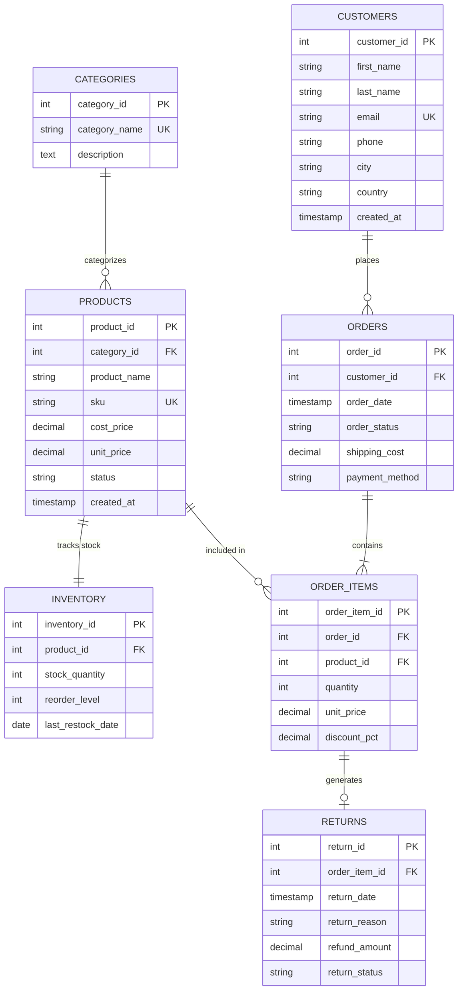

# 🛒 Retail & E-Commerce Relational Database Management System (SQL Portfolio)

Designed & Implemented by **Ahmed Fikry**  
*Data & BI Analyst | SQL & Relational Database Designer*

---

## 📌 Project Overview
In modern retail and e-commerce enterprises, maintaining data integrity, eliminating redundancies, and enabling fast analytical decision-making is foundational. 

This project demonstrates the end-to-end design and implementation of a **3rd Normal Form (3NF) Relational Database** built from scratch. It handles the complete retail lifecycle:
* **Customer Management** across geographic territories.
* **Product Catalog & Categorization**.
* **Inventory Stock Control & Automated Restock Alerts**.
* **Order Processing & Itemized Transactions**.
* **Returns & Refund Pipeline** with root-cause categorization.
* **Executive Analytical Reporting** using advanced SQL techniques (*CTEs, Window Functions, Aggregate Rollups*).

---

## 🏗️ Database Architecture & Entity-Relationship Diagram (ERD)



---

## 🛡️ Key Database Design & Integrity Constraints

1. **3NF Normalization**: All non-key attributes are fully functionally dependent solely on the primary key, avoiding transitive dependencies and update anomalies.
2. **Domain & Business Constraints (`CHECK`)**:
   - `products.unit_price >= products.cost_price`: Guarantees no product is priced below cost.
   - `order_items.discount_pct BETWEEN 0 AND 100`: Prevents invalid promotional discounts.
   - `inventory.stock_quantity >= 0`: Prevents negative physical inventory.
   - Strict `ENUM`/Value constraints for order statuses (`Pending`, `Processing`, `Shipped`, `Delivered`, `Cancelled`) and return reasons (`Defective`, `Size Mismatch`, `Damaged in Transit`, etc.).
3. **Referential Integrity & Cascading Rules**:
   - `ON DELETE CASCADE` between `orders` and `order_items` (deleting an order cleanly cascades).
   - `ON DELETE RESTRICT` on catalog items to prevent accidental deletion of products tied to historical transactions.
4. **Performance Indexing**:
   - B-Tree indexes created on high-cardinality foreign keys and filter columns (`customer_id`, `order_date`, `city`, `product_id`).

---

## 💼 Executive Business Scenarios & Advanced SQL Queries

### Query 1: Executive Financial KPI Dashboard
**Business Question:** *What is our realized net revenue, total discounts given, refunds granted, cost of goods sold, and actual gross profit margin?*

```sql
WITH SalesMetrics AS (
    SELECT 
        SUM(oi.quantity * oi.unit_price) AS gross_revenue,
        SUM(oi.quantity * oi.unit_price * (oi.discount_pct / 100.0)) AS total_discounts,
        SUM(oi.quantity * oi.unit_price * (1.0 - (oi.discount_pct / 100.0))) AS net_revenue,
        SUM(oi.quantity * p.cost_price) AS total_cogs
    FROM order_items oi
    JOIN products p ON oi.product_id = p.product_id
    JOIN orders o ON oi.order_id = o.order_id
    WHERE o.order_status NOT IN ('Cancelled')
),
RefundMetrics AS (
    SELECT COALESCE(SUM(refund_amount), 0.00) AS total_refunds
    FROM returns
    WHERE return_status IN ('Refunded', 'Approved')
)
SELECT 
    ROUND(sm.gross_revenue, 2) AS gross_revenue_egp,
    ROUND(sm.total_discounts, 2) AS total_discounts_egp,
    ROUND(sm.net_revenue, 2) AS net_revenue_egp,
    ROUND(rm.total_refunds, 2) AS total_refunds_egp,
    ROUND(sm.net_revenue - rm.total_refunds, 2) AS final_realized_revenue_egp,
    ROUND(sm.total_cogs, 2) AS cogs_egp,
    ROUND((sm.net_revenue - rm.total_refunds) - sm.total_cogs, 2) AS gross_profit_egp,
    ROUND((((sm.net_revenue - rm.total_refunds) - sm.total_cogs) / (sm.net_revenue - rm.total_refunds)) * 100.0, 2) AS profit_margin_pct
FROM SalesMetrics sm
CROSS JOIN RefundMetrics rm;
```

**Results:**
| Gross Revenue (EGP) | Discounts | Net Revenue | Total Refunds | Realized Revenue | COGS | Gross Profit | Profit Margin % |
| :---: | :---: | :---: | :---: | :---: | :---: | :---: | :---: |
| 50,765.00 | 2,635.55 | 48,129.45 | 5,591.50 | **42,537.95** | 31,400.00 | **11,137.95** | **26.18%** |

---

### Query 2: Product Profitability vs. Return Rate Analysis
**Business Question:** *Which products generate the highest profit, and which products are suffering from high return rates eroding profitability?*

```sql
WITH ProductSales AS (
    SELECT 
        p.product_id,
        p.product_name,
        c.category_name,
        p.unit_price,
        p.cost_price,
        SUM(oi.quantity) AS units_sold,
        SUM(oi.quantity * oi.unit_price * (1.0 - (oi.discount_pct / 100.0))) AS net_sales,
        SUM(oi.quantity * p.cost_price) AS total_cost
    FROM products p
    JOIN categories c ON p.category_id = c.category_id
    JOIN order_items oi ON p.product_id = oi.product_id
    JOIN orders o ON oi.order_id = o.order_id
    WHERE o.order_status <> 'Cancelled'
    GROUP BY p.product_id, p.product_name, c.category_name, p.unit_price, p.cost_price
),
ProductReturns AS (
    SELECT 
        oi.product_id,
        COUNT(r.return_id) AS total_returns_count,
        COALESCE(SUM(r.refund_amount), 0.00) AS total_refunded
    FROM order_items oi
    JOIN returns r ON oi.order_item_id = r.order_item_id
    WHERE r.return_status IN ('Refunded', 'Approved')
    GROUP BY oi.product_id
)
SELECT 
    ps.product_name,
    ps.category_name,
    ps.units_sold,
    ROUND(ps.net_sales, 2) AS net_sales_egp,
    COALESCE(pr.total_returns_count, 0) AS units_returned,
    ROUND(COALESCE((pr.total_returns_count * 100.0) / ps.units_sold, 0.0), 1) AS return_rate_pct,
    ROUND(ps.net_sales - COALESCE(pr.total_refunded, 0) - ps.total_cost, 2) AS net_profit_egp,
    DENSE_RANK() OVER (ORDER BY (ps.net_sales - COALESCE(pr.total_refunded, 0) - ps.total_cost) DESC) AS profitability_rank
FROM ProductSales ps
LEFT JOIN ProductReturns pr ON ps.product_id = pr.product_id
ORDER BY profitability_rank;
```

**Key Insight:** While the **Ultra HD 4K Monitor** ranked #1 in profitability (+2,968 EGP profit, 0% returns), items like **Running Shoes** and **Smart Fitness Trackers** suffered 33%-50% return rates due to sizing and defects, turning potential profits into negative net margins.

---

### Query 3: Running Total & Month-Over-Month (MoM) Growth
**Business Question:** *How is revenue pacing month-over-month, and what is our cumulative revenue trajectory?*

Techniques: `LAG()` Window Function, Cumulative `SUM(...) OVER (...)`.

```sql
WITH MonthlySales AS (
    SELECT 
        SUBSTR(o.order_date, 1, 7) AS sales_month,
        COUNT(DISTINCT o.order_id) AS total_orders,
        SUM(oi.quantity * oi.unit_price * (1.0 - (oi.discount_pct / 100.0))) AS monthly_net_revenue
    FROM orders o
    JOIN order_items oi ON o.order_id = oi.order_id
    WHERE o.order_status <> 'Cancelled'
    GROUP BY SUBSTR(o.order_date, 1, 7)
)
SELECT 
    sales_month,
    total_orders,
    ROUND(monthly_net_revenue, 2) AS current_month_revenue,
    ROUND(LAG(monthly_net_revenue, 1) OVER (ORDER BY sales_month), 2) AS previous_month_revenue,
    ROUND(
        ((monthly_net_revenue - LAG(monthly_net_revenue, 1) OVER (ORDER BY sales_month)) 
        / LAG(monthly_net_revenue, 1) OVER (ORDER BY sales_month)) * 100.0, 
    2) AS mom_growth_rate_pct,
    ROUND(SUM(monthly_net_revenue) OVER (ORDER BY sales_month ROWS BETWEEN UNBOUNDED PRECEDING AND CURRENT ROW), 2) AS cumulative_running_revenue
FROM MonthlySales
ORDER BY sales_month;
```

---

### Query 4: RFM Customer Value Segmentation
**Business Question:** *How can we segment our customer base based on frequency and lifetime spend to tailor retention campaigns?*

```sql
WITH CustomerAggregates AS (
    SELECT 
        c.customer_id,
        c.first_name || ' ' || c.last_name AS customer_name,
        c.city,
        COUNT(DISTINCT o.order_id) AS order_frequency,
        MAX(o.order_date) AS last_order_date,
        SUM(oi.quantity * oi.unit_price * (1.0 - (oi.discount_pct / 100.0))) AS monetary_value
    FROM customers c
    JOIN orders o ON c.customer_id = o.customer_id
    JOIN order_items oi ON o.order_id = oi.order_id
    WHERE o.order_status <> 'Cancelled'
    GROUP BY c.customer_id, c.first_name, c.last_name, c.city
)
SELECT 
    customer_id,
    customer_name,
    city,
    order_frequency,
    ROUND(monetary_value, 2) AS total_spent_egp,
    last_order_date,
    CASE 
        WHEN monetary_value >= 5000 AND order_frequency >= 3 THEN 'VIP Platinum Customer'
        WHEN monetary_value >= 3000 OR order_frequency >= 2 THEN 'Loyal Repeat Customer'
        WHEN monetary_value >= 1500 THEN 'Mid-Tier Value'
        ELSE 'One-Time / Low Value'
    END AS customer_segment
FROM CustomerAggregates
ORDER BY monetary_value DESC;
```

---

### Query 5: Inventory Reorder & Stockout Prevention Alert
**Business Question:** *Which items are below reorder threshold and what working capital is needed to replenish them?*

```sql
SELECT 
    p.product_id,
    p.product_name,
    c.category_name,
    i.stock_quantity,
    i.reorder_level,
    (i.reorder_level - i.stock_quantity) AS stock_deficit,
    ROUND((i.reorder_level - i.stock_quantity) * p.cost_price, 2) AS estimated_restock_cost_egp,
    CASE 
        WHEN i.stock_quantity = 0 THEN 'CRITICAL: OUT OF STOCK'
        WHEN i.stock_quantity <= (i.reorder_level / 2) THEN 'URGENT: HIGH STOCKOUT RISK'
        WHEN i.stock_quantity <= i.reorder_level THEN 'WARNING: REORDER NEEDED'
        ELSE 'HEALTHY STOCK'
    END AS inventory_status
FROM inventory i
JOIN products p ON i.product_id = p.product_id
JOIN categories c ON p.category_id = c.category_id
WHERE i.stock_quantity <= i.reorder_level
ORDER BY i.stock_quantity ASC;
```

---

## 🚀 How to Run & Verify

1. **Clone the repository:**
   ```bash
   git clone https://github.com/your-username/retail-sql-database-portfolio.git
   cd retail-sql-database-portfolio
   ```

2. **Automated Run via Python:**
   ```bash
   python test_database.py
   ```
   *This initializes the database, executes the DDL schema, seeds the mock data, runs all 5 analytical queries, and prints formatted results to the console with zero dependencies.*

3. **Or load directly into your favorite SQL tool (PostgreSQL, DBeaver, SQLite, MySQL):**
   - Run `01_schema.sql`
   - Run `02_seed_data.sql`
   - Run `03_business_queries.sql`

---

## 🛠️ Tech Stack & Concepts
- **Languages:** ANSI SQL, PostgreSQL / SQLite
- **Techniques:** 3NF Normalization, Constraints (`CHECK`, `UNIQUE`, `NOT NULL`), Foreign Key Cascades, B-Tree Indexes, Views, Common Table Expressions (CTEs), Window Functions (`DENSE_RANK`, `LAG`, `SUM() OVER`), RFM Segmentation.
- **Tools:** Python (Automated testing runner), Mermaid.js (ERD generation).
